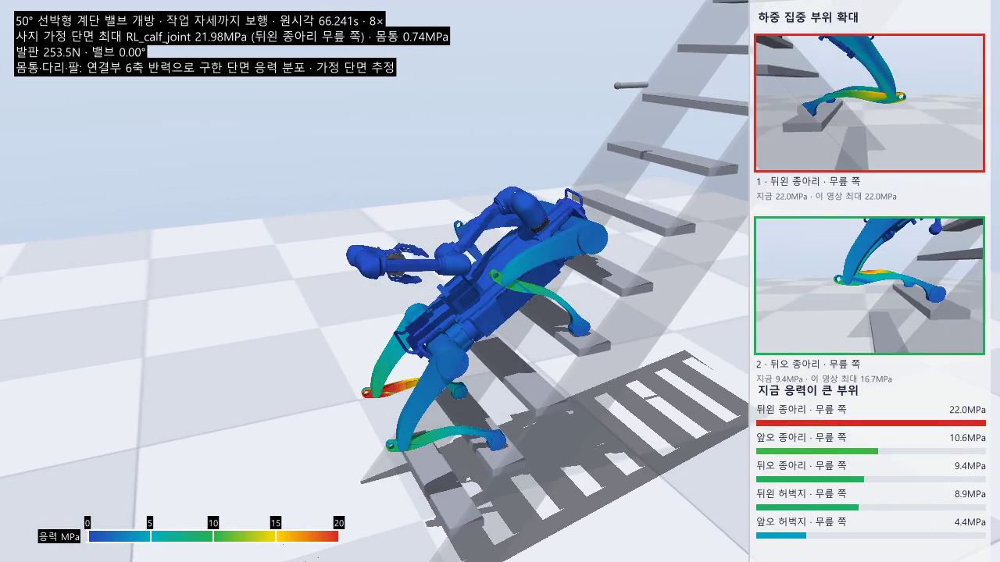

# RBQ Ship Stair Valve Lab

MuJoCo study of an RBQ-10 quadruped with its RB1 arm that climbs a 50-degree ship stair, opens a quarter-turn valve while standing on the treads, and stops on the stair. Loads on the trunk, legs and arm are computed along the whole run.



## Why

Energy and shipbuilding companies already run quadrupeds on inspection rounds, where the robot reads gauges and valve positions. Turning a manual valve is still done by a person who climbs a steep stair to reach it. To take over that work, a legged robot has to hold its stance on the treads while its arm overcomes the valve torque, and we need to know where that load goes in the robot.

## Results

- **Mission.** Starting on the floor, the robot makes 18 landings onto a 50-degree stair with a 19 cm rise, with front feet on tread 5 and rear feet on tread 3. It opens a 10 N m valve through 90 degrees with two finger pads on a 0.12 m lever, holds it for five seconds, releases it, folds the arm and stands for another five seconds. Two independent 127.75 s runs produced identical records across 34 shared arrays. Foot displacement during the valve stroke stayed within 4.44 mm. [Full run](evidence/stair-open-20261122/nominal/mission.mp4) · [Valve close-up](evidence/stair-open-20261122/nominal/valve.mp4) · [Measurements](evidence/stair-open-20261122/README.md)
- **Robot choice.** The lever tip needs 83.3 N. A Go2 with a D1 arm reaches at most 14.0 N and with a Z1 arm 70.5 N, so neither turns the valve at any of 96 placements; foot friction times body weight sets the limit. RBQ-10 with RB1 (48.95 kg) succeeds at 74 of 96 placements on the 50-degree stair. [Valve capacity](docs/valve-capacity.md)
- **Learned walking and the RL Triage Agent.** A PPO stair policy reached the work stance in 0 of 32 perturbed starts because the trunk underside hit the stair. The RL Triage Agent cited those trunk collisions, selected a contact-feedback controller that follows a successful demonstration and corrects the posture from the loaded feet, and adopted it after a physics check. That controller completed the strict mission 12 of 16 times on each of two independent sets of starts, with no trunk contact. Fixing the best development controller selected the same one. After the agent was changed to drop failed proposals and verify the next repair, strict success on 12 new starts rose from 0 to 10. [Paired results and reproduction](evidence/rbq-agent-body-20261122/README.md)
- **Where the load goes.** Each link and the trunk are coloured per pixel from the six-axis wrenches at their joints, carried along the part to give thin-wall section stress on one 0 to 20 MPa scale. The peak is 21.98 MPa at the left rear calf near the knee, against 16.7 MPa on the right. The reference demonstration keeps the trunk about 2 cm left of the footprint centre, so the left legs carry 54 to 58 percent of the vertical load. The trunk stays at or below 0.84 MPa. These are estimates from assumed sections, not finite-element results. [Load video](evidence/rbq-agent-body-20261122/heatmap/agent-holdout.mp4) · [Valve close-up](evidence/rbq-agent-body-20261122/heatmap/agent-holdout-valve.mp4)
- **Steeper stair.** On the 60-degree comparison stair, approach planning stopped at 13.60 s when the body overlapped tread 3 by 0.684 mm.

## Setup

```bash
python -m venv .venv
.venv/Scripts/python -m pip install -e ".[test]"
.venv/Scripts/python tools/fetch_assets.py
.venv/Scripts/python -m pytest
```

The RBQ-10, RB1, Go2, D1 and Z1 models are fetched from their upstream repositories, pinned by commit and SHA-256 in `configs/assets.lock.json`, and stay out of this repository. The Python package keeps the name `go2_wall` from the earlier Go2 study; `arm="rb1"` selects RBQ-10 with RB1. Training runs in a separate WSL environment described in `docs/train-throughput.md`.

## Main commands

```bash
python -m go2_wall.stairs --out evidence/<run-id> --arm rb1
python -m go2_wall.valve_arc --out evidence/<run-id> --arm rb1 --slope 50 --gap 3
python tools/verify_rbq_agent_study.py evidence/rbq-agent-body-20261122
python tools/render_stair_mission.py <run-dir> <out.mp4> --follow-base --body-stress
```

## Layout

- `src/go2_wall/`: model builder, statics, stair and valve scenes, transition controller, load observer
- `tools/`: replay, verification, RL Triage Agent studies, load field and video rendering
- `train/`: RBQ-10 stair task for `unitree_rl_mjlab`, evaluation and diagnostics
- `docs/`: stair feasibility, valve capacity, stair transfer and contact mission, policy evaluation
- `evidence/`: results, judgements and videos

Raw physics recordings larger than 5 MB are not included, so a few links in `docs/` and `evidence/` point to files that are not in this repository.
